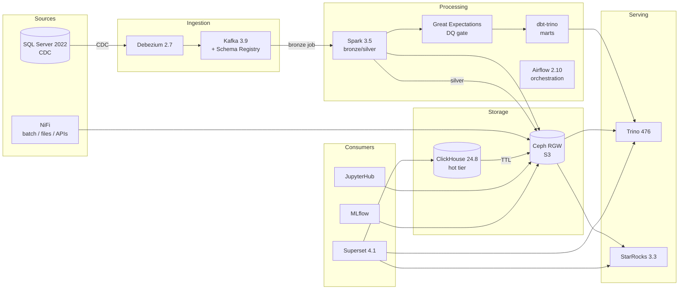

# LakeHouse

[](https://docs.docker.com/compose/)
[](https://www.microsoft.com/sql-server)
[](https://kafka.apache.org/)
[](https://spark.apache.org/)
[](https://iceberg.apache.org/)
[](https://trino.io/)
[](https://clickhouse.com/)
[](https://www.starrocks.io/)
[](https://ceph.io/)

A single-host **Docker Compose Lakehouse** implementing the full modern data-stack pipeline:

> **Sources → Ingestion & Contracts → Storage & Hot Tier → Processing & Orchestration → Table Format & Catalog → Serving → Consumers**, with cross-cutting ops (auth, secrets, observability, governance, edge routing).

---

## 📑 Table of Contents

- [Prerequisites](#prerequisites)
- [Quick Start](#-quick-start)
- [Control Commands](#control-commands)
- [Architecture](#-architecture)
- [Layers & Services](#layers--services)
- [Data Flow](#-data-flow)
- [Host Ports](#-host-ports)
- [Benchmark Suite](#-benchmark-suite)
- [Operations](#operations)
- [Documentation](#-documentation)

## Prerequisites

| Requirement | Notes |
|---|---|
| Docker Engine + Compose v2 | Single host is sufficient |
| ~8 GB RAM | Ceph OSDs, Spark, ClickHouse, and OpenSearch are the heavy consumers |
| Sudo (optional) | Needed only once to add `*.lakehouse.local` entries to `/etc/hosts` |
| `./lakehouse.sh hosts` | Prints the exact host-file entries |

## 🚀 Quick Start

```bash
cd ~/Dockers/LakeHouse
./lakehouse.sh init              # .env + rendered configs + image builds
./lakehouse.sh up all            # start everything (builds/pulls on first run)
./lakehouse.sh bootstrap-ceph    # once: S3 user + buckets (waits for HEALTH_OK)
./lakehouse.sh seed-mssql        # once: CDC setup + sample rows
./lakehouse.sh register-cdc      # once: Debezium connector
./lakehouse.sh starrocks-add-be  # once: register BE with FE
./lakehouse.sh vault-init        # once: init/unseal Vault
./lakehouse.sh smoke             # end-to-end integration check
./lakehouse.sh urls              # print all UI endpoints + creds
```

> 💡 `./lakehouse.sh init` generates all secrets into `.env` — never commit that file.

## Control Commands

```bash
./lakehouse.sh up [phase|all]      # base sources ingestion storage catalog
                                   # processing serving consumers ops ops-ha
./lakehouse.sh down|stop|restart [phase|all]
./lakehouse.sh status | logs [service] | build | pull
./lakehouse.sh backup | restore <ts> | reset | hosts
```

You can also start the stack **incrementally, in dependency order**:

```text
storage → bootstrap-ceph → sources → ingestion → register-cdc → catalog
       → processing → serving → starrocks-add-be → consumers → ops
```

## 🏗 Architecture



## Layers & Services

| Phase | Layer | Services |
|:---:|---|---|
| 0 | Foundation | shared PostgreSQL (7 DBs), `lakehouse` network `172.31.100.0/24` |
| 1 | Sources | SQL Server 2022 (CDC-enabled `lakehouse_src.dbo.customers`) |
| 2 | Ingestion & Contracts | Kafka 3.9 (KRaft), Schema Registry 7.7, Debezium 2.7, NiFi 1.28, Kafka UI |
| 3 | Storage & Hot Tier | Ceph MON+MGR+OSD+RGW (S3), ClickHouse 24.8 (TTL → S3 cold volume) |
| 4 | Processing & Orchestration | Spark 3.5 (Iceberg + Kafka jars), Airflow 2.10 (LocalExecutor), dbt-trino, Great Expectations |
| 5 | Table Format & Catalog | Iceberg REST catalog 1.6 (JDBC/Postgres backend, S3FileIO → Ceph) |
| 6 | Serving | Trino 476 (REST catalog + native S3), StarRocks 3.3 (FE+BE) |
| 7 | Consumers | Superset 4.1, JupyterHub 5.2 (+DockerSpawner), MLflow 2.19 (S3 artifacts) |
| 8 | Cross-cutting Ops | Vault 1.17, Keycloak 26.6 (SSO + realm import), OpenMetadata 1.6 (+OpenSearch), Prometheus / Grafana / Loki / Promtail, OPA (Trino access control), HAProxy edge (+ optional Keepalived for multi-host) |

## 🔁 Data Flow

```text
SQL Server --CDC(Debezium)--> Kafka --bronze job--> Iceberg bronze (Ceph S3)
NiFi --batch/files/APIs------> s3://lake-landing  -+
                                                  v
                        Spark silver (dedup) -> Iceberg silver (Ceph S3)
                                                  |
                          Great Expectations DQ gate (via Trino)
                                                  v
                        dbt marts (staging/dim via Trino)
                                                  |
        +-----------------+----------------------+
        v                 v                      v
    Trino 476       StarRocks FE/BE        ClickHouse hot tier (TTL -> S3)
        ^                 ^                      ^
        +-------- Superset (BI) ----------------+
                      + JupyterHub/MLflow (artifacts on Ceph)
```

## 🌐 Host Ports

All ports were chosen to avoid conflicts with common stacks (`5050 / 5433 / 6333 / 8082 / 8088 / 9443 / 27017`). Canonical list: `.env` → *"Host ports"* section, or simply run:

```bash
./lakehouse.sh urls
```

| Service | Host Port | Service | Host Port |
|---|---:|---|---:|
| HAProxy edge (HTTP) | `10080` | Superset | `18888` |
| SQL Server | `11433` | Grafana | `13000` |
| PostgreSQL | `15432` | JupyterHub | `18500` |
| Kafka | `19092` | MLflow | `18501` |
| Schema Registry | `18081` | Keycloak | `18088` |
| Debezium Connect | `18083` | Vault | `18200` |
| Kafka UI | `18090` | OpenMetadata | `18558` |
| NiFi | `18443` | OpenSearch | `19200` |
| Ceph RGW (S3) | `18800` | Prometheus | `19090` |
| ClickHouse HTTP / Native | `18123` / `19000` | OPA | `18191` |
| Spark Master / UI | `17077` / `18084` | StarRocks MySQL / HTTP | `19030` / `18030` |
| Airflow | `18085` | Loki | `13100` |
| Iceberg REST Catalog | `18181` | Trino | `18430` |

## 📊 Benchmark Suite

A 3-phase empirical benchmark lives in [`benchmarks/`](benchmarks/) (results: [`benchmarks/benchmark_results.json`](benchmarks/benchmark_results.json), scripts kept for reproducibility). Dataset: synthetic TPC-DS-like data (2 M-row `lineorder`, seed 42, regenerated via `benchmarks/gen_dataset.py`).

| Phase | Test | Headline result |
|:---:|---|---|
| 1 | Analytical queries — Trino/Iceberg vs ClickHouse | ClickHouse **9.2–15.1× faster** (medians 0.042–0.070 s vs 0.451–0.867 s) |
| 1 | Load test — k6, 50 VUs on ClickHouse | p95 **692 ms**, **0%** errors, **141.8 req/s** |
| 2 | CDC ingestion — SQL Server → Debezium → Kafka → ClickHouse, 1 M rows | E2E **51.1 s**; ClickHouse stores it in **27.0 MB** (2.74× compression) |
| 3 | Failover — single-node ClickHouse restart under load via HAProxy | **12.3 s** unavailability window, clean 503s, instant recovery |

Re-run any phase:

```bash
python3 benchmarks/phase1_query_latency.py && \
k6 run benchmarks/phase1_loadtest.js && \
python3 benchmarks/phase2_cdc_ingestion.py && \
python3 benchmarks/phase3_failover.py
```

## Operations

- `./lakehouse.sh status | logs <service> | smoke | backup | restore <ts> | reset`
- **Backup**: Postgres dumps + named-volume archives + upload to `s3://lake-backups` (see [`docs/runbook.md`](docs/runbook.md)).
- **Edge routing**: HAProxy routes `*.lakehouse.local` (`./lakehouse.sh hosts`, needs sudo).
- **Keepalived**: only meaningful with a second host — `./lakehouse.sh up ops-ha`.

## 📚 Documentation

| Document | Contents |
|---|---|
| [`docs/architecture.md`](docs/architecture.md) | Layer map & integration contract per service |
| [`docs/runbook.md`](docs/runbook.md) | Per-service operations, SSO wiring, DR procedures |

## Project Layout

```text
LakeHouse/
├── lakehouse.sh           # one-stop control script (init/up/smoke/backup/...)
├── docker-compose.*.yml   # one compose file per phase/layer
├── sources/ ingestion/ storage/ catalog/   # per-phase service configs
├── processing/            # Spark jobs, dbt, Great Expectations, Airflow
├── serving/ consumers/    # Trino/StarRocks, Superset/Jupyter/MLflow
├── ops/                   # HAProxy, OPA, Keycloak, observability stack
├── scripts/               # helper + smoke-test scripts
├── benchmarks/            # 3-phase benchmark suite + results
├── docs/                  # architecture & runbook
└── V2/                    # next-iteration compose layout (experimental)
```
